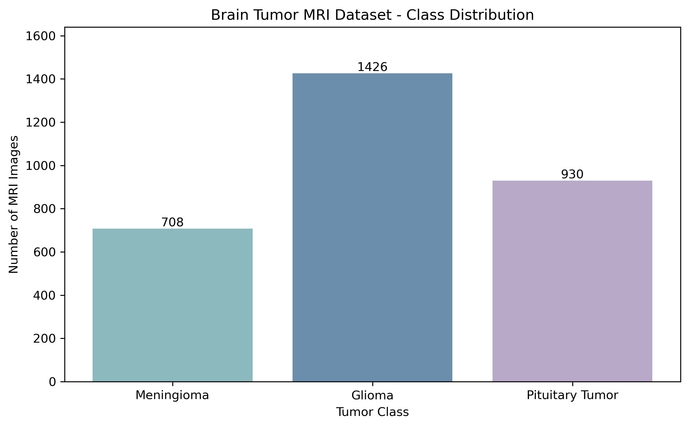
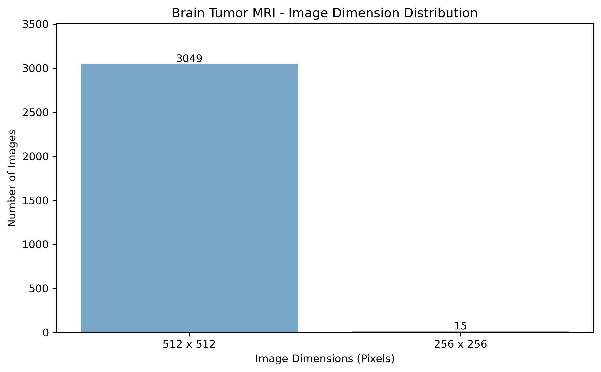
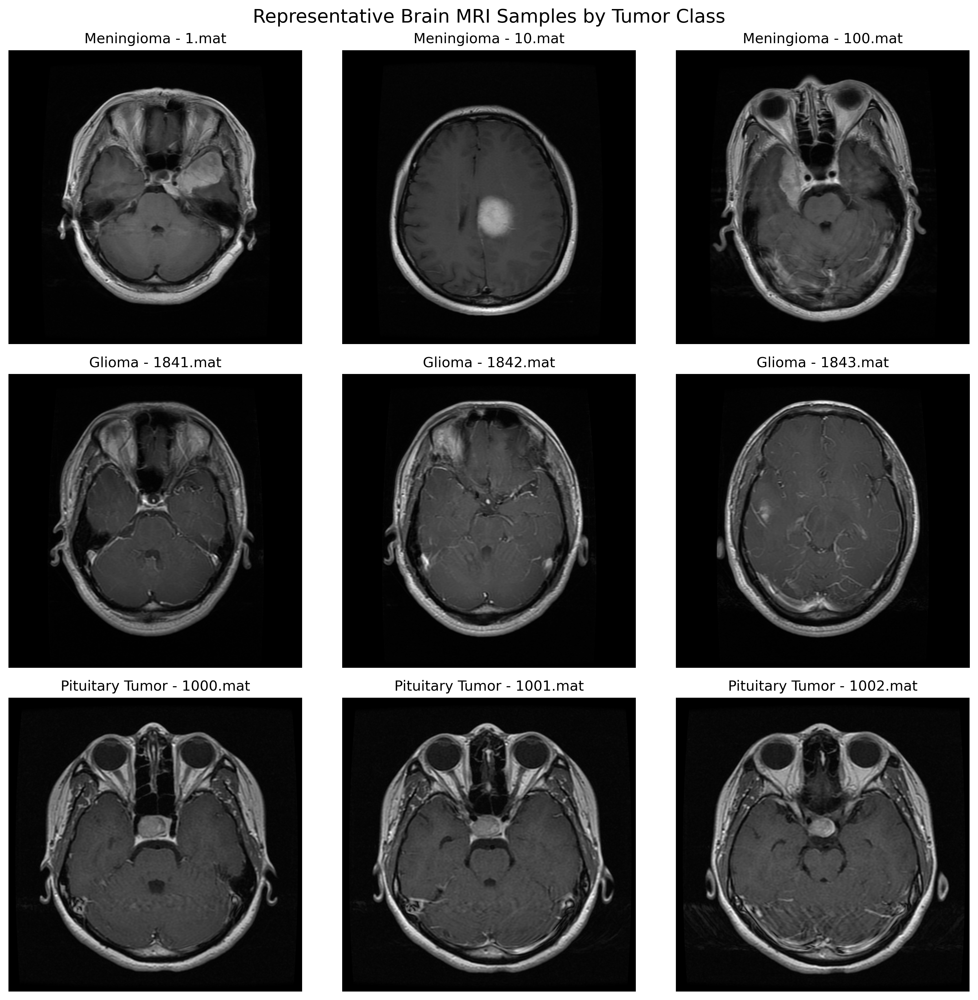

# Week 1 – Data Quality and Preprocessing Checkpoint

**Project:** Healthcare Diagnostic Lab Image Classification  
**Prepared by:** Veda M V  
**Date:** 24 November 2026

## 1. Overview

The main objective of this checkpoint is to assess the quality of the selected brain tumor MRI dataset and identify the preprocessing steps required before model training.

The findings are based on the exploratory data analysis completed on 23 November and the additional data quality validation performed on 24 November.

## 2. Dataset Information

- Dataset: Brain Tumor Dataset by Jun Cheng
- Source: Figshare
- DOI: https://doi.org/10.6084/m9.figshare.1512427
- License: CC BY 4.0
- Image modality: T1-weighted contrast-enhanced MRI
- Total images: 3,064
- Total patients: 233
- File format: MATLAB (.mat)
- Number of classes: 3

The team acquisition document references Figshare Version 5.
The local EDA dataset was downloaded from Version 8.
The observed dataset counts match the team documentation,
but exact equivalence between the versions has not been verified.

## 3. Exploratory Data Analysis Findings

### Class Distribution

| Tumor Type | Image Count | Percentage |
|---|---:|---:|
| Meningioma | 708 | 23.1% |
| Glioma | 1,426 | 46.5% |
| Pituitary Tumor | 930 | 30.4% |
| Total | 3,064 | 100% |

Glioma has the highest number of samples, while meningioma
has the lowest. This imbalance should be considered during
model training and performance evaluation.

### Image Dimensions

| Image Dimensions | Number of Images |
|---|---:|
| 512 x 512 | 3,049 |
| 256 x 256 | 15 |

Most images have a resolution of 512 x 512 pixels.
However, the presence of different image dimensions makes
resizing necessary before model training.

### Representative MRI Samples

Sample images from all three tumor categories were visualized
to understand their appearance and structural characteristics.

## 4. Data Quality Validation

All 3,064 MRI image files were checked using Python,
NumPy and h5py.

The following validation results were obtained:

| Validation Check | Issues Detected |
|---|---:|
| Unreadable files | 0 |
| Missing required fields | 0 |
| Invalid class labels | 0 |
| Empty images | 0 |
| Constant images | 0 |
| Non-finite pixel values | 0 |
| Image-mask dimension mismatches | 0 |

All images passed the implemented validation checks.
No files were identified for removal based on these checks.

The validation code and results are available in:

[EDA Notebook](../notebooks/2.0-brain-tumor-eda.ipynb)

## 5. Recommended Preprocessing Steps

Based on the EDA and validation findings, the following
preprocessing steps are recommended before model training.

### Image Resizing

Resize images to a consistent input dimension.
An initial input size of 224 x 224 pixels is proposed,
subject to the selected model architecture and evaluation
of retained image detail.

### Normalization

Apply consistent pixel intensity normalization to improve
training stability. Any dataset-level normalization
statistics should be calculated using training data only.

### Channel Conversion

Convert grayscale images to the required number of channels
depending on the selected CNN or pretrained architecture.

### Class Imbalance Handling

Consider class weights or balanced sampling during training
to reduce bias towards the majority class.

### Data Augmentation

Apply suitable transformations such as small rotations,
translations and controlled intensity adjustments.

Augmentation should be applied only to the training set
and should preserve meaningful anatomical features.

### Tumor Masks

Retain the original tumor masks for potential localization
and explainability analysis.

Ground-truth tumor masks should not be used as classifier
inputs in the planned image-only classification task.

## 6. Data Splitting and Leakage Prevention

Since the dataset contains multiple MRI images from the
same patient, randomly splitting individual images may
cause data leakage.

A patient-level split is recommended to ensure that images
from the same patient do not appear in multiple subsets.

The planned split is:

- Training set: 70%
- Validation set: 15%
- Test set: 15%

Class distribution should be preserved as closely as
possible across the subsets.

Patient overlap and duplicate image checks should be
completed before model training.

## 7. Dataset Limitations

- The dataset contains only three brain tumor categories.
- There is no healthy or no-tumor class.
- The number of images differs across tumor categories.
- Multiple images belong to the same patient.
- Generalization to other hospitals, scanners and patient
  populations has not been established.
- Structural validation does not establish clinical image
  quality or diagnostic reliability.
- The dataset is intended for research and educational
  purposes, not clinical diagnosis.

## 8. Raw Data Protection

The original MRI files have been kept unchanged.

Raw dataset files are excluded from Git tracking through
the project's .gitignore configuration.

Preprocessing outputs should be stored in data/interim
or data/processed rather than modifying the original files.

## 9. Checkpoint Status

| Task | Status |
|---|---|
| Dataset inspection | Completed |
| Exploratory data analysis | Completed |
| Class distribution analysis | Completed |
| Image dimension analysis | Completed |
| Data quality validation | Completed |
| Preprocessing recommendations | Completed |
| Preprocessing implementation | Pending |
| Duplicate detection | Pending |
| Patient-level split verification | Pending |

## 10. Conclusion

The Week 1 analysis provides a clear understanding of the
dataset structure, class distribution and image quality
based on the implemented validation checks.

No structural issues were detected during the additional
validation of all 3,064 MRI images.

The dataset is ready to proceed to the planned preprocessing
stage, subject to the remaining duplicate detection and
patient-level leakage checks.

The next stage will focus on implementing the dataset loader,
image preprocessing and patient-level data splitting.
